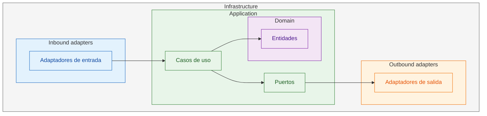

# POC de arquitectura hexagonal con NestJS

## Propósito

Esta es una POC educativa para aprender arquitectura hexagonal aplicada a NestJS. El ejemplo modela una solicitud de inscripción de un estudiante a un curso, separando el dominio de HTTP, NestJS y la persistencia.

## Estado actual

Los hitos 1–4 están implementados:

1. Dominio de inscripciones.
2. Aplicación y caso de uso.
3. Adaptador de persistencia en memoria y composición mediante NestJS.
4. Entrada HTTP REST.

Actualmente queda un test de dominio (`test/enrollment/domain/entities/enrollment.spec.ts`). Los tests restantes se agregarán después.

La persistencia actual es únicamente en memoria; al reiniciar la aplicación se pierde el estado.

## Vista concéntrica general de una arquitectura hexagonal



Leyenda: las flechas representan dependencias estáticas, no el flujo de ejecución.

Esta vista muestra los límites y las dependencias estáticas, mientras que el diagrama posterior muestra el flujo de ejecución.

## Flujo arquitectónico

```mermaid
flowchart LR
    subgraph inbound[Inbound adapter]
        direction TB
        httpIn[HTTP request] --> requestDto[RequestEnrollmentDto]
        requestDto --> pipe[ValidationPipe]
        pipe --> controller[EnrollmentsController]
        resultDto[RequestEnrollmentResponseDto] --> httpOut[HTTP response]
        http400[HTTP 400]
        conflict[ConflictException]
        http409[HTTP 409]
        errorPolicy[Input error policy]
    end

    subgraph core[Core]
        direction TB
        subgraph application[Application]
            command[RequestEnrollmentCommand]
            useCase[RequestEnrollmentUseCase]
            duplicate[EnrollmentExistsActiveQuery]
            port["EnrollmentRepositoryPort<br/>existsActive(EnrollmentExistsActiveQuery)<br/>save(EnrollmentEntity): void"]
            result[RequestEnrollmentResult]
            activeError[RequestEnrollmentExistsActiveError]
        end

        subgraph domain[Domain]
            entity[EnrollmentEntity]
            status[EnrollmentStatusValueObject]
            transitionError[InvalidEnrollmentTransitionError<br/>domain error only outside initial request flow]
        end
    end

    subgraph outbound[Outbound adapter]
        adapter[InMemoryEnrollmentRepositoryAdapter]
        record[EnrollmentPersistenceRecord]
    end

    controller --> command --> useCase
    useCase --> duplicate --> port
    port --> adapter
    adapter -->|duplicate check result| useCase
    useCase --> entity
    entity --> status
    useCase -->|save entity| port
    port -->|save| adapter
    adapter -->|map and store| record
    useCase --> result
    result --> resultDto
    pipe -->|invalid DTO| http400
    useCase -->|active enrollment found| activeError
    activeError -->|handled by controller| controller
    controller --> conflict --> http409
    entity -.->|invalid transition| transitionError
    transitionError -.-> errorPolicy

    classDef inboundStyle fill:#e8f1ff,stroke:#356ae6
    classDef applicationStyle fill:#fff4d6,stroke:#b7791f
    classDef domainStyle fill:#e8f8ed,stroke:#2f855a
    classDef outboundStyle fill:#f5e8ff,stroke:#805ad5
    classDef errorStyle fill:#fff0f0,stroke:#c53030
    classDef noteStyle fill:#f7fafc,stroke:#718096,stroke-dasharray: 5 5
    class httpIn,requestDto,pipe,controller,resultDto,httpOut,http400,conflict,http409,errorPolicy inboundStyle
    class command,useCase,duplicate,port,result,activeError applicationStyle
    class entity,status,transitionError domainStyle
    class adapter,record outboundStyle
    class activeError,transitionError,conflict,http400,http409 errorStyle
    class errorPolicy noteStyle
```



Leyenda: `Core` agrupa `Application` y `Domain`; las flechas muestran el flujo y las dependencias coordinadas por el caso de uso.

El flujo de ejecución atraviesa los adapters inbound y outbound mediante la aplicación, mientras que la dirección de dependencias apunta hacia el dominio: `infrastructure → application → domain`. Ambas direcciones no son iguales. El dominio no depende de NestJS, HTTP, ORM ni base de datos.

## Objetos y fronteras

| Objeto | Propósito | Dirección/capa | Ejemplo en esta POC |
| --- | --- | --- | --- |
| Request/HTTP DTO | Representar y validar el contrato de entrada externo | Entrante, infrastructure | `RequestEnrollmentDto` |
| Input port | Definir la capacidad de aplicación que invoca un actor externo | Entrante, application | El caso de uso concreto `RequestEnrollmentUseCase` expresa este puerto en la POC |
| Command | Transportar la intención y los datos de una operación | Entrante, application | `RequestEnrollmentCommand` entra al caso de uso |
| Use case/application service | Orquestar la operación y aplicar el flujo de aplicación | Application | `RequestEnrollmentUseCase` |
| Domain entity | Representar identidad, estado y reglas de negocio | Domain | `EnrollmentEntity` (la entidad `Enrollment`) |
| Domain event | Representar un hecho de negocio ocurrido en el dominio | Saliente, domain | La POC aún no publica eventos; conceptualmente podría ser `EnrollmentRequested` |
| Query/criteria | Describir una consulta o criterio para el puerto | Application | `EnrollmentExistsActiveQuery` sirve para consultar el puerto |
| Output port | Abstraer una dependencia que la aplicación necesita hacia afuera | Saliente, application | `EnrollmentRepositoryPort` |
| Persistence record/model | Adaptar la forma de datos propia de un mecanismo de persistencia | Interno al adapter, infrastructure | `EnrollmentPersistenceRecord` representa la forma de datos que guarda el adapter |
| Result | Transportar la salida de la operación de aplicación | Application | `RequestEnrollmentResult` |
| Response DTO | Representar el contrato de salida HTTP | Saliente, infrastructure | `RequestEnrollmentResponseDto` |

El puerto de persistencia expone `save(EnrollmentEntity): void` para guardar la entidad. El adapter la mapea a `EnrollmentPersistenceRecord`; `RequestEnrollmentCommand` sigue siendo la entrada al caso de uso, mientras `EnrollmentExistsActiveQuery` es el criterio de consulta.

## Puertos de aplicación

Conceptualmente existen puertos de entrada (*input/driving ports*), invocados por los actores externos, y puertos de salida (*output/driven ports*), que la aplicación usa para comunicarse con recursos externos. En esta POC, el input port todavía se expresa mediante el use case concreto `RequestEnrollmentUseCase`, y el output port mediante `EnrollmentRepositoryPort`, cuyo método de guardado es `save(EnrollmentEntity): void`.

## Infrastructure

`infrastructure` puede contener configuración, bootstrap, mappers, clientes externos, persistencia y adapters; no todo tiene que ser un adapter. En esta POC solo se necesita `infrastructure/adapters`.

## Estructura actual de `src/`

```text
src/
├── main.ts
├── app.module.ts
└── enrollment/
    ├── enrollment.module.ts
    ├── application/
    │   ├── commands/
    │   │   └── request-enrollment-command.ts
    │   ├── errors/
    │   │   └── request-enrollment-exists-active-error.ts
    │   ├── ports/
    │   │   └── enrollment-repository-port.ts
    │   ├── query/
    │   │   └── enrollment-exists-active-query.ts
    │   ├── result/
    │   │   └── request-enrollment-result.ts
    │   ├── tokens/
    │   │   └── enrollment-repository.token.ts
    │   └── use-cases/
    │       └── request-enrollment-use-case.ts
    ├── domain/
    │   ├── entities/
    │   │   └── enrollment-entity.ts
    │   ├── errors/
    │   │   └── invalid-enrollment-transition-error.ts
    │   └── value-objects/
    │       └── enrollment-status-value-object.ts
    └── infrastructure/
        └── adapters/
            ├── inbound/
            │   ├── dto/
            │   │   ├── request-enrollment-dto.ts
            │   │   └── request-enrollment-response-dto.ts
            │   └── rest/
            │       └── enrollments.controller.ts
            └── outbound/
                └── persistence/
                    ├── enrollment-persistence-record.ts
                    └── in-memory-enrollment-repository-adapter.ts
```

## Responsabilidades por capa

- **`main.ts`**: arranca NestJS, configura la validación global de DTOs y escucha en `PORT` o en el puerto `3000` por defecto.
- **`app.module.ts`**: compone los módulos de la aplicación.
- **`enrollment/`**: módulo funcional de inscripciones; mantiene juntas sus capas y su composición.
- **`domain/`**: núcleo de negocio independiente de la infraestructura. `EnrollmentEntity` representa una inscripción, el value object representa sus estados y el error expresa transiciones inválidas.
- **`application/`**: orquesta el caso de uso sin conocer HTTP ni la implementación de persistencia. El command es la entrada, `EnrollmentExistsActiveQuery` describe la consulta, `EnrollmentRepositoryPort` expone la persistencia —incluido `save(EnrollmentEntity): void`—, el result es la salida y el token permite inyectar el adapter en NestJS.
- **`infrastructure/adapters/inbound/`**: entrada desde el exterior. El controller expone `POST /enrollments`, transforma el DTO en command y el result en DTO de respuesta; los DTOs validan y estabilizan el contrato HTTP.
- **`infrastructure/adapters/outbound/`**: salida hacia persistencia. El adapter en memoria implementa `EnrollmentRepositoryPort` y transforma `EnrollmentEntity` en `EnrollmentPersistenceRecord`, sin que el caso de uso dependa de él.

## Convenciones de nombres y consistencia

La estructura actual usa nombres en inglés y nombres explícitos por responsabilidad:

- `*-entity`, `*-value-object`, `*-error` para conceptos del dominio.
- `*-command`, `*-query`, `*-result`, `*-port` y `*-use-case` para aplicación.
- `*-dto`, `*.controller` y `*-adapter` para infraestructura.
- Carpetas organizadas por capa y por tipo de componente.

La convención recomendada es mantener esta distinción:

- **`Enrollment`** es el concepto de dominio: la entidad de inscripción y sus reglas.
- **`RequestEnrollment`** es una operación/caso de uso: solicitar una inscripción, junto con sus command, result, DTOs y errores específicos.

## Ejecución y verificación

Instalar dependencias y ejecutar desde este directorio:

```bash
npm install
npm run start
```

Comandos disponibles en `package.json`:

```bash
npm run build       # compilar la aplicación
npm run deploy      # ejecutar el despliegue de Nest
npm run format      # formatear src/ y test/
npm run start       # iniciar la aplicación
npm run start:dev   # iniciar con watch
npm run start:debug # iniciar con debug y watch
npm run start:prod  # ejecutar dist/main
npm run lint        # lint con comprobación de tipos
npm run test        # ejecutar tests una vez
npm run test:watch  # ejecutar tests en modo watch
npm run test:cov    # ejecutar tests con cobertura
```

No hay un script `typecheck` separado en `package.json`; `lint` usa `oxlint --type-aware` y `build` comprueba la compilación TypeScript como parte de la verificación disponible.

La entrada HTTP principal es `POST /enrollments` con `studentId` y `courseId` en el cuerpo. La aplicación usa `PORT` si está definido y, en caso contrario, el puerto `3000`.
